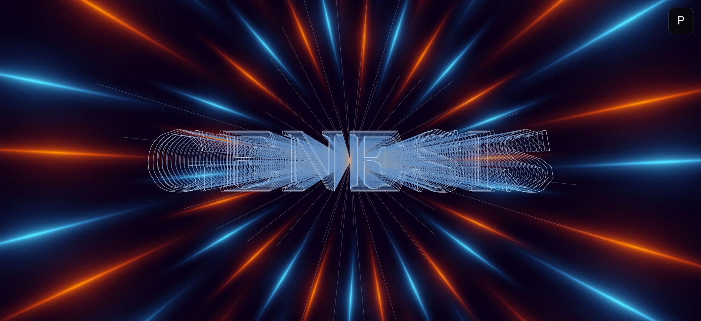

# GENESIS 0.9 — BRING YOUR SHAPE

### A generative art engine. Bring your shape. Explore infinite possibilities.

[▶ Explore GENESIS](https://mcoqyes.github.io/Genesis/)

What is GENESIS?

GENESIS is an experimental generative art engine that transforms geometry into complex visual compositions through iterative generation.

It starts with a simple idea: a shape can become much more than itself.

Using geometric transformations, repetition, scaling, rotation, color and stroke variations, GENESIS builds intricate structures and visual patterns from simple primitives — or from shapes you bring into the engine yourself.

It is a space for exploration, experimentation, and creative discovery.

Bring Your Shape

GENESIS 0.9 introduces the ability to bring external artwork into the generative process.

Import your own:

SVG — vector shapes and paths.

PNG — raster images.

JPG — raster images.

GENESIS interprets the imported geometry and converts it into its own internal representation, allowing your shapes, symbols, and patterns to become the starting point for new generative compositions.

Bring a shape. Bring a symbol. Bring a pattern.

Features

Generative Engine

Iterative geometric generation.

Multiple built-in primitives.

Custom primitives.

Radial and directional generation.

Adjustable scale, rotation, and geometry parameters.

Your Own Shapes

Built-in primitive editor.

Multiple paths and custom geometry.

SVG interpretation.

PNG and JPG raster-to-vector conversion.

Integration with the GENESIS generation engine.

Strokes & Colors

Solid, dashed, and dotted strokes.

Multiple color modes.

Gradient and alternate color variations.

Monochrome and spectrum modes.

Creative Experience

Superposition: combine generated compositions.

WARP: explore an infinite visual journey.

Custom backgrounds: stars, colors, and images.

Natural zoom and interactive exploration.

Surprise Me: discover unexpected combinations.

Getting Started

No installation or programming knowledge is required.

Visit GENESIS.

Let the opening experience introduce the engine.

Explore the controls and experiment with the available parameters.

Use BRING YOUR SHAPE to import your own artwork.

Generate, combine, and explore.

GENESIS runs directly in your browser.

Keyboard Shortcuts — GePaRaHe

GENESIS includes four keyboard shortcuts:

Key

Action

G

Generate

P

Panel Toggle

R

Randomize

H

Help

GePaRaHe — Generate · Panel · Randomize · Help.

Screenshots & Creations

GENESIS is designed to encourage experimentation. Every primitive, imported shape, and combination of parameters can lead to a different visual result.

Share what you create and explore what others discover.

(More examples and creations will be added here.)

Roadmap

GENESIS is an evolving creative experiment.

Version 0.9 — BRING YOUR SHAPE — expands the engine beyond its built-in geometry, allowing external shapes and artwork to become part of the generative process.

Future development will continue exploring new creative possibilities, usability improvements, and ways to make the experience more accessible.

Credits

Created by MCO with ASTER.

GENESIS is an independent generative art project developed through experimentation, geometry, programming and creative collaboration.

Contact & Collaboration

Ideas, feedback, bug reports, and creative collaborations are welcome.

Email: GenesisArt@proton.me

Live project: https://mcoqyes.github.io/Genesis/

Bring your shape. Discover what it can become.
